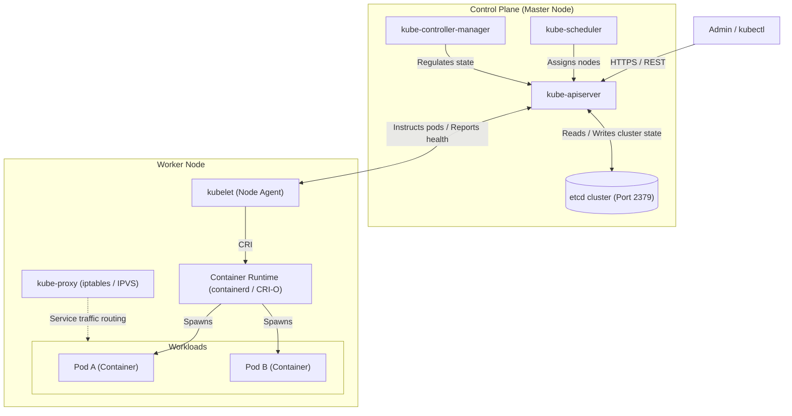

# CKA (Certified Kubernetes Administrator) - Quick Study Guide

A concise reference sheet for CKA exam preparation, aligned strictly with the [Official Kubernetes Documentation](https://kubernetes.io/docs/home/).

---

## 1. Cluster Architecture

Kubernetes clusters consist of **Control Plane (Master)** nodes that manage the cluster state and **Worker Nodes** that run containerized workloads.



### Control Plane Components

*All components manage cluster state and decisions. In kubeadm clusters, these run as **Static Pods** in `/etc/kubernetes/manifests/`.*

- **`kube-apiserver`**: The front-door/gateway to the cluster.
  - Exposes the Kubernetes API (REST).
  - Authenticates and validates requests.
  - **The *only* component that directly reads from and writes to `etcd`**.
- **`etcd`**: High-availability, distributed key-value store holding the entire cluster state, configs, and secrets.
- **`kube-scheduler`**: Decides *which node* a pod should run on.
  - Filters and scores nodes based on resource requests/limits, taints/tolerations, node affinity, and anti-affinity.
  - *Note:* It only makes the placement decision; the **kubelet** actually runs the pod.
- **`kube-controller-manager`**: Runs core control loops to match current state with desired state:
  - *Node Controller*: Monitors node health (evicts after timeout).
  - *Replication / Deployment Controller*: Ensures correct pod counts.
  - *Endpoints / Service Account Controllers*, etc.
- **`cloud-controller-manager`**: (Optional) Interfaces with cloud-provider APIs (load balancers, storage volumes, routes).

### Worker Node Components

*Responsible for running and maintaining user container workloads.*

- **`kubelet`**: The node agent running on every node (control plane & workers).
  - Registers the node with `kube-apiserver`.
  - Watches for PodSpecs assigned to its node and instructs the container runtime to launch/stop containers via CRI.
  - Reports pod and node health back to `kube-apiserver`.
  - *Runs as a systemd service* (not a pod).
- **`kube-proxy`**: Network proxy running on each node (DaemonSet).
  - Programs `iptables` or `IPVS` rules to enable Kubernetes `Service` networking (ClusterIP, NodePort) and traffic routing to pods.
- **Container Runtime**: Software that executes containers (e.g., `containerd`, `CRI-O`). Communicates with kubelet via CRI.

---

## 2. Container Runtimes & CLIs

### Standards

- **OCI (Open Container Initiative)**: Open industry specifications:
  - `image-spec`: How container images are packaged and layered.
  - `runtime-spec`: How to run a container (e.g., low-level runtime `runc`).
- **CRI (Container Runtime Interface)**: Kubernetes API enabling `kubelet` to communicate with any container runtime without recompiling Kubernetes.

### The Dockershim Removal

- Docker predated CRI, so Kubernetes initially included an internal bridge called **`dockershim`**.
- **Deprecated in v1.20 and removed in v1.24**.
- Kubernetes now uses native CRI-compliant runtimes: **`containerd`** and **`CRI-O`**.
- *Note on container images:* Docker images still run fine because they adhere to the OCI `image-spec`.

### Runtime CLI Comparison (Exam Reference)

| CLI Tool      | Target Runtime  | Purpose & Context                                                                      | Exam Relevance                                                          |
| :------------ | :-------------- | :------------------------------------------------------------------------------------- | :---------------------------------------------------------------------- |
| **`docker`**  | Docker Engine   | Legacy developer tool; interacts with Docker daemon.                                   | Not used on modern K8s worker nodes.                                    |
| **`ctr`**     | containerd      | Low-level debugging CLI shipped directly with containerd. Raw and non-user-friendly.   | Rarely needed; scoped by namespace (`ctr -n k8s.io ...`).               |
| **`nerdctl`** | containerd      | Docker-compatible CLI for containerd (supports compose, rootless, Docker-like UX).     | General container management on containerd hosts.                       |
| **`crictl`**  | Any CRI runtime | **The official Kubernetes CRI debugging tool.** Communicates directly with CRI socket. | **High Exam Relevance** (debugging node issues when kubelet is broken). |

### Essential `crictl` Commands

`crictl` treats pods and containers as Kubernetes entities:

```bash
# List pods and containers
crictl pods
crictl ps -a

# View logs and execute commands inside a container
crictl logs <container-id>
crictl exec -i -t <container-id> sh

# Inspect image and container details
crictl images
crictl inspect <container-id>
crictl inspectp <pod-id>   # inspect pod sandbox

# Default endpoint configuration (/etc/crictl.yaml)
# runtime-endpoint: unix:///run/containerd/containerd.sock
```

---

## 3. ETCD Deep Dive & Operations

### Overview

- **Type**: Distributed, consistent key-value store.
- **Port**: `2379` (client requests from `kube-apiserver`), `2380` (peer cluster communication).
- **Consensus**: Uses the **Raft** consensus algorithm.
  - Quorum formula: $Q = \lfloor N/2 \rfloor + 1$ (requires majority).
  - Odd number of members recommended ($3$, $5$) to tolerate failures:
    - 3-node cluster tolerates **1** failure ($Q=2$).
    - 5-node cluster tolerates **2** failures ($Q=3$).
- **Storage**: In Kubernetes, all cluster objects are stored under the `/registry/` key prefix.

### ETCD in K8s (kubeadm)

In kubeadm clusters, etcd runs as a static pod:

- Manifest: `/etc/kubernetes/manifests/etcd.yaml`
- Data directory on host: `/var/lib/etcd`
- Certificates directory: `/etc/kubernetes/pki/etcd/`

Check etcd pod status:

```bash
kubectl get pods -n kube-system -l component=etcd
```

---

## 4. `etcdctl` CLI & Exam Workflows

Always set `ETCDCTL_API=3` (or prefix commands) because Kubernetes uses etcd v3:

```bash
export ETCDCTL_API=3
```

### Basic Commands

```bash
# Put and Get keys
etcdctl put mykey myvalue
etcdctl get mykey

# List all keys with prefix (e.g., all K8s keys)
etcdctl get / --prefix --keys-only
```

### Authentication Flags (Required in K8s)

Since etcd in Kubernetes enforces mutual TLS, all `etcdctl` commands require certificates:

- `--cacert`: `/etc/kubernetes/pki/etcd/ca.crt` (CA cert)
- `--cert`: `/etc/kubernetes/pki/etcd/server.crt` (Server/client cert)
- `--key`: `/etc/kubernetes/pki/etcd/server.key` (Server/client private key)
- `--endpoints`: `https://127.0.0.1:2379`

> **Exam Tip**: You can copy these paths directly from `/etc/kubernetes/manifests/etcd.yaml` (`--trusted-ca-file`, `--cert-file`, `--key-file`).

### Check Endpoint Health

```bash
ETCDCTL_API=3 etcdctl \
  --endpoints=https://127.0.0.1:2379 \
  --cacert=/etc/kubernetes/pki/etcd/ca.crt \
  --cert=/etc/kubernetes/pki/etcd/server.crt \
  --key=/etc/kubernetes/pki/etcd/server.key \
  endpoint health
```

---

## 5. ETCD Backup & Restore (Must-Know for CKA)

### Step 1: Snapshot (Backup)

Take a snapshot and save it to a target path:

```bash
ETCDCTL_API=3 etcdctl snapshot save /opt/snapshot-pre-boot.db \
  --endpoints=https://127.0.0.1:2379 \
  --cacert=/etc/kubernetes/pki/etcd/ca.crt \
  --cert=/etc/kubernetes/pki/etcd/server.crt \
  --key=/etc/kubernetes/pki/etcd/server.key
```

Verify snapshot integrity:

```bash
ETCDCTL_API=3 etcdctl snapshot status /opt/snapshot-pre-boot.db --write-out=table
```

### Step 2: Restore from Snapshot

Restore into a **new data directory** (do not restore into the existing active directory without backing it up):

```bash
ETCDCTL_API=3 etcdctl snapshot restore /opt/snapshot-pre-boot.db \
  --data-dir=/var/lib/etcd-from-backup
```

*(No certificates are required during `snapshot restore` because it does not communicate with the running cluster).*

### Step 3: Update ETCD Static Pod Manifest

Update `/etc/kubernetes/manifests/etcd.yaml` to use the restored data directory:

1. Locate the `hostPath` volume for `etcd-data`:

   ```yaml
   volumes:
   - name: etcd-data
     hostPath:
       path: /var/lib/etcd-from-backup  # <-- update from /var/lib/etcd
       type: DirectoryOrCreate
   ```

2. (Optional/If configured) Update the container mount path or `--data-dir` argument if hostPath mapping requires it.
3. Save the file. `kubelet` detects file changes automatically and restarts the `etcd` static pod.
4. Verify cluster health:

   ```bash
   kubectl get nodes
   kubectl get pods -A
   ```
